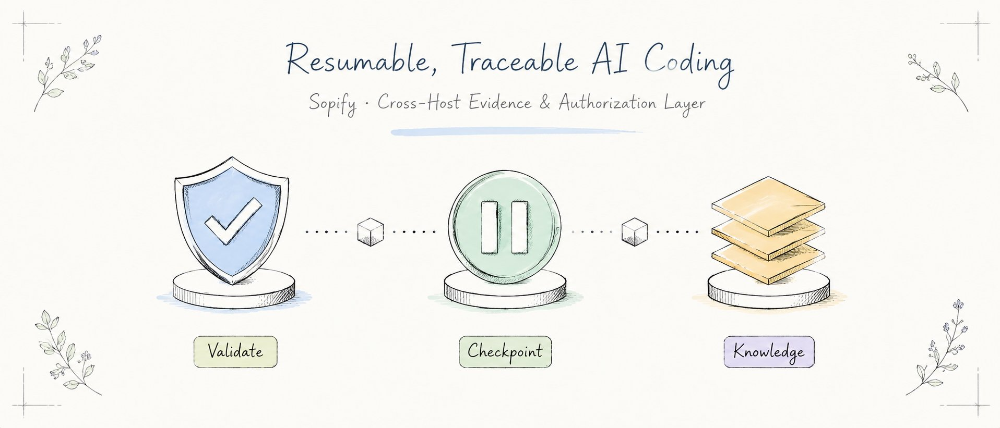
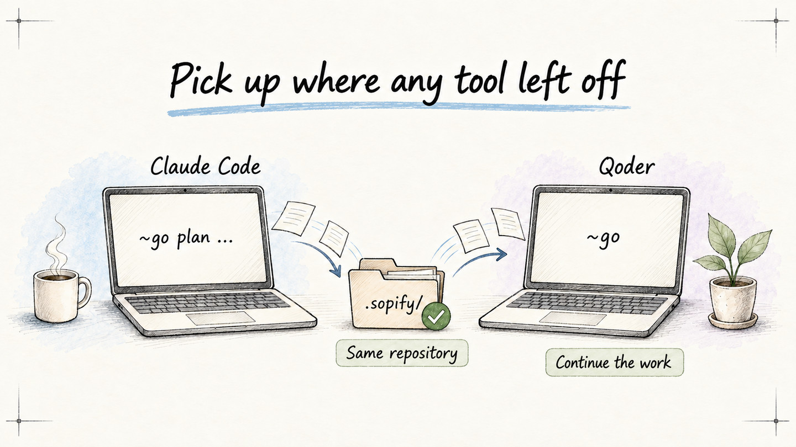
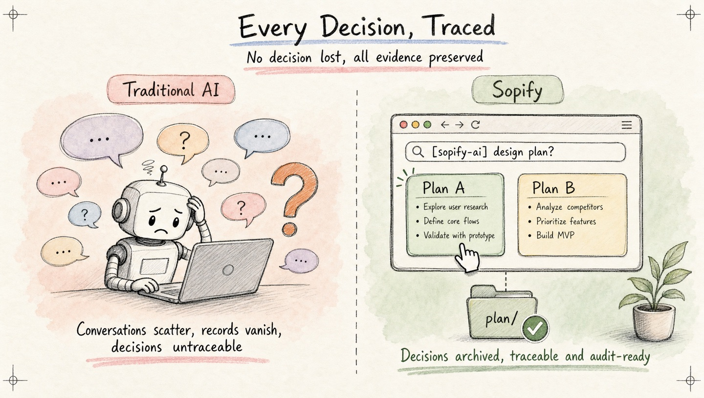

# Sopify

<div align="center">

**AI coding plans and proof in your repo — keep building across tools, teammates, and agents.**

Installs into the AI coding tools you already use. Questions and small fixes stay direct.

[](./LICENSE) [](#version-history)

[](#supported-hosts) [](#supported-hosts) [](#supported-hosts) [](#supported-hosts)
[](#supported-hosts) [](#supported-hosts) [](#supported-hosts)

English · [简体中文](./README.zh-CN.md) · [Quick Start](#quick-start) · [Contributors](./CONTRIBUTORS.md)

</div>

<div align="center">

</div>

---

Sopify is a set of rules and Skills that installs into the AI coding tool you already use. When work needs a plan, it saves the plan, the decisions and the verification evidence as ordinary files under `.sopify/` in your repo, so the next session — another tool, another person, another agent — continues from the record instead of from memory. Not a new editor, not a new CLI.

## Quick Start

**1. Install into your tool.**

```bash
curl -fsSL https://github.com/evidentloop/sopify/releases/latest/download/install.sh | bash -s -- --target codex:en-US
```

| Your tool | `--target` |
|---|---|
| Codex | `codex:en-US` / `codex:zh-CN` |
| Claude Code | `claude:en-US` / `claude:zh-CN` |
| Qoder | `qoder` |
| Copilot | `copilot:en-US` / `copilot:zh-CN` |
| Cursor | `cursor:en-US` / `cursor:zh-CN` |
| Antigravity | `antigravity:en-US` / `antigravity:zh-CN` |
| Trae (Preview) | `trae:en-US` / `trae:zh-CN` |

Python 3.11 or newer; the installer checks before downloading. It writes host instructions and Skills only — no daemon, no runtime, no new editor.

**2. In your project, type one line into the chat box.**

```text
~go plan add input validation to the signup form
```

Sopify asks about anything still unresolved, then writes `.sopify/plan/YYYYMMDD_signup_form_validation/plan.md`. It changes no business code at this step.

**3. Run the plan, then archive it.**

```text
~go            # implement the plan task by task, recording verification evidence
~go finalize   # move the finished plan to .sopify/history/
```

The plan and its evidence stay in git, so another supported tool can pick the work back up.

Windows uses the PowerShell installer instead of step 1:

```powershell
iwr https://github.com/evidentloop/sopify/releases/latest/download/install.ps1 -OutFile sopify-install.ps1
.\sopify-install.ps1 --target codex:en-US
```

## Where It Pays Off

**A long task gets interrupted.**
Before: the session ends and the reasoning ends with it. After: `~go` reads `.sopify/plan/` and resumes at the next unfinished task.

**Another tool or another person takes over.**
Before: paste the context again and hope nothing important was dropped. After: this release was built that way — a plan written by Claude Code was continued by a fresh Qoder session whose only input was `~go`.

**Several agents split the work.**
Before: two agents edit the same files and overwrite each other. After: one owner holds the plan, workers take bounded tasks, and the evidence lands in one place. See [Using Sopify with Orca](./docs/orca.md).

<div align="center">

</div>

<div align="center">

</div>

## When Not to Use It

- Questions, code reading, and explanations
- Small fixes: a rename, a typo, a one-line style change
- Throwaway scripts and exploratory tries

These are handled directly and never enter the plan workflow. A plan starts only when you ask for one with `~go plan`, when you ask to continue work in progress, or when `~go` decides the request needs a plan.

## Command Cheat Sheet

| Command | When to type it |
|---|---|
| `~go plan <request>` | New work that needs a plan. Writes `.sopify/plan/<id>/plan.md` and changes no code |
| `~go` | Start or continue. Routes the current request, and resumes the active plan when there is one |
| `~go finalize` | Close out the active plan and move it to `.sopify/history/` |

## Supported Hosts

| Host | Status | Install |
|---|---|---|
| Codex | Verified | `--target codex:en-US` / `codex:zh-CN` |
| Claude Code | Verified | `--target claude:en-US` / `claude:zh-CN` |
| Qoder | Verified | `--target qoder` |
| Copilot | Baseline | `--target copilot:en-US` / `copilot:zh-CN` |
| [Cursor](./docs/cursor-host.md) | Baseline | `--target cursor:en-US` / `cursor:zh-CN` |
| [Antigravity](./docs/antigravity-host.md) | Baseline; dogfooded in a real session | `--target antigravity:en-US` / `antigravity:zh-CN` |
| [Trae](./docs/trae-host.md) | Preview — not yet verified in a real session | `--target trae:en-US` / `trae:zh-CN` |

Verified means the managed workflow has been run in a real session on that host, not only installed. Baseline means installation, rule visibility and Skill selection are recorded, while not every scenario has been proven in a real session. Preview means the adapter is in place but no real session has confirmed it yet.

## A Real Case

This archived workflow ran inside Codex; it is not a scripted terminal demo. A complex request became a tracked plan, an audit concern stopped the work for a user decision, and after the user approved a minimal fix the verification evidence was recorded and the plan was archived.

<p align="center">
  
</p>

- **Plan first** — Codex did not start coding immediately; it captured the goal, boundaries and verification steps in a tracked plan.
- **Stop for a decision** — the first audit found one concern; work paused for the user, then only a minimal identity check was added.
- **Close with evidence** — the second audit found no open risk; 5 protocol checks and 55 targeted tests with 48 subtests were recorded before archive.

The real task was an optional verifier integration. The animation shows how Sopify managed it; the archived files show what happened: [plan](./.sopify/history/2026-07/20260718_evidentloop_optional_audit_integration/plan.md) · [verification receipt](./.sopify/history/2026-07/20260718_evidentloop_optional_audit_integration/receipts/verify_001.json) · [final receipt](./.sopify/history/2026-07/20260718_evidentloop_optional_audit_integration/receipts/final.json).

## Further Reading

- [How Sopify Works](./docs/how-sopify-works.en.md) — workflow stages, checkpoints, the four files a new session reads first, the `.sopify/` layout, and the [product form](./assets/sopify-product-form-release-en.svg) and architecture diagrams
- [Getting Started](./docs/getting-started.md) — install details, inspecting the script before running it, host-specific setup, updating, removing, and the optional EvidentLoop companion
- [Using Sopify with Orca](./docs/orca.md) — owner, executor and reviewer roles for multi-agent work
- [Host Onboarding](./docs/host-onboarding.md) — how a new host adapter is probed and recorded
- [External Repo Quickstart](./examples/external-repo-quickstart/README.md) — step-by-step demo on a repo that is not Sopify's own
- [Configuration example](./examples/sopify.config.yaml) — optional `sopify.config.yaml` overrides; defaults work without it

## Version History

- See [CHANGELOG.md](./CHANGELOG.md) for the detailed history

## License

- Code and config: Apache 2.0, see [LICENSE](./LICENSE)
- Documentation: CC BY 4.0, see [LICENSE-docs](./LICENSE-docs)

## Contributing

For user-visible behavior changes, update both `README.md` and `README.zh-CN.md` when needed, then follow [CONTRIBUTING.md](./CONTRIBUTING.md) for validation.
