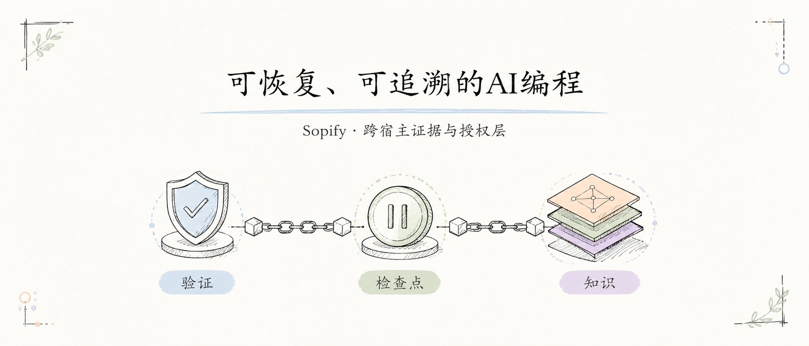
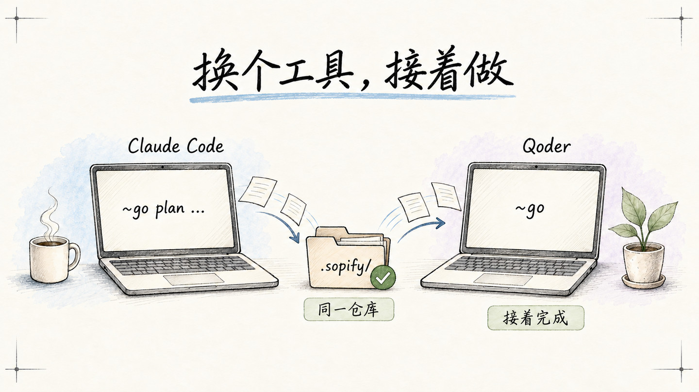
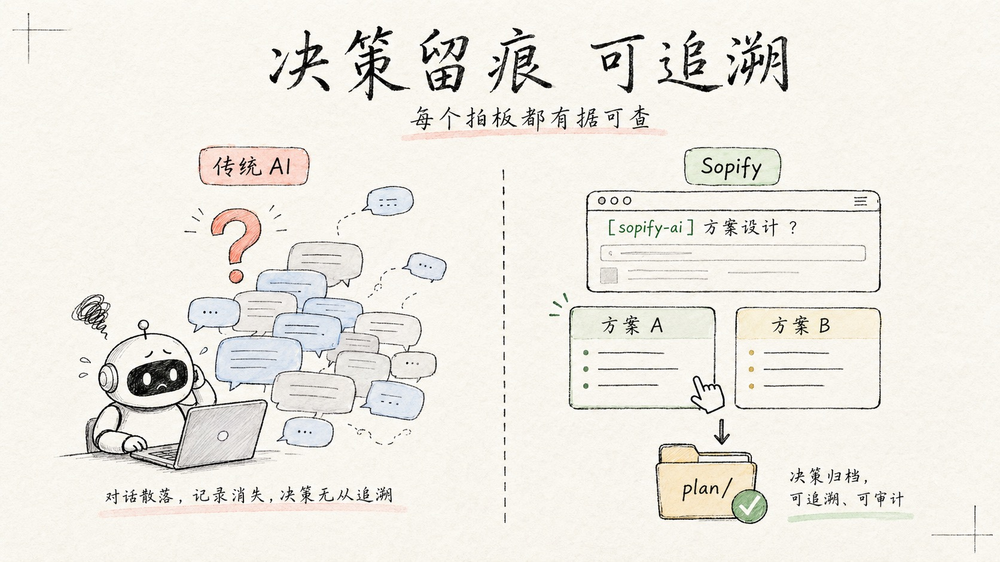

# Sopify

<div align="center">

**AI 编程的方案与验收证据纳入 Git 版本管理，跨工具、跨成员、跨 Agent 均可接续。**

安装到你现有的 AI 编程工具；日常问答和小修直接处理，需要时才生成方案。

[](./LICENSE) [](#版本历史)

[](#支持的宿主) [](#支持的宿主) [](#支持的宿主) [](#支持的宿主) [](#支持的宿主) [](#支持的宿主) [](#支持的宿主)

[English](./README.md) · 简体中文 · [快速开始](#快速开始) · [贡献者](./CONTRIBUTORS.md)

</div>

<div align="center">

</div>

---

Sopify 是一套规则和 Skill，装进你已经在用的 AI 编程工具。需要方案的工作，它会把方案、决策和验收证据作为普通文件保存在 `.sopify/` 并纳入 Git；下一个会话——换一个工具、换一个人、换一个 agent——从这份记录接续，而不是靠记忆重来。

## 快速开始

**1. 装进你的工具。**

```bash
curl -fsSL https://github.com/evidentloop/sopify/releases/latest/download/install.sh | bash -s -- --target codex:zh-CN
```

| 你用哪个工具 | `--target` |
|---|---|
| Codex | `codex:zh-CN` / `codex:en-US` |
| Claude Code | `claude:zh-CN` / `claude:en-US` |
| Qoder | `qoder:zh-CN` / `qoder:en-US` |
| Copilot | `copilot:zh-CN` / `copilot:en-US` |
| Cursor | `cursor:zh-CN` / `cursor:en-US` |
| Antigravity | `antigravity:zh-CN` / `antigravity:en-US` |
| Trae | `trae:zh-CN` / `trae:en-US` |

需要 Python 3.11 或更高版本，安装器会在下载前检查。它只写入宿主指令和 Skill。

**2. 在项目里，往聊天框输入一行。**

```text
~go plan 给注册表单加上输入校验
```

Sopify 会先追问还没定的事实，等你在对话里回答后才写 `.sopify/plan/YYYYMMDD_signup_form_validation/plan.md`。非交互会话（如 `-p` / `--print`）下提问会结束本轮——把答案写进请求再发一次即可。这一步不改业务代码。

**3. 执行方案，做完归档。**

```text
~go            # 按任务推进方案，并记录验收证据
~go finalize   # 把做完的方案移到 .sopify/history/
```

方案和证据都留在 Git 里，换到其他受支持的工具时可以接续。

### 仓库里会多出什么

| 路径 | 是什么 | 是否提交 |
|---|---|---|
| `.sopify/sopify.json` | 项目标记 | 提交 |
| `.sopify/plan/`、`.sopify/history/` | 方案与验收证据 | 提交 |
| `.sopify/state/` | 本机指针：当前活动方案与接续提示 | 不提交；默认通过 `.git/info/exclude` 忽略 |

Windows 用 PowerShell 安装器替代第 1 步：

```powershell
iwr https://github.com/evidentloop/sopify/releases/latest/download/install.ps1 -OutFile sopify-install.ps1
.\sopify-install.ps1 --target codex:zh-CN
```

## 价值场景

**长任务做到一半被打断。**
以前：会话结束，思路也一起结束。现在：`~go` 读 `.sopify/plan/`，从下一个未完成的任务接续。

**换工具或换人接手。**
以前：把上下文重新粘贴一遍，还得担心漏掉关键约束。现在：这个版本就是这样做出来的——一个只收到 `~go` 的全新 Qoder 会话，接续了 Claude Code 写下的方案。

**多个 agent 分工。**
以前：两个 agent 改同一批文件，互相覆盖。现在：一个 owner 持有方案，worker 领取有边界的任务，证据落在同一个地方。见[在 Orca 中使用 Sopify](./docs/orca.md)。

<div align="center">

</div>

<div align="center">

</div>

## 什么时候不用

- 问答、读代码、要解释
- 小修：改名字、修拼写、调一行样式
- 一次性脚本和探索性尝试

这些请求直接处理，不进入方案流程。只有在你输入 `~go plan`、明确要求接续未完成工作，或 `~go` 判定需要时，才会建立方案。

## 命令速查

| 命令 | 什么时候输入 |
|---|---|
| `~go plan <需求>` | 需要方案的新工作——不清楚时先追问，等你回答后才写 `.sopify/plan/<id>/plan.md`，不改代码 |
| `~go` | 开始或继续。按当前请求路由，有活动方案时就接续 |
| `~go finalize` | 收口当前活动方案，并移到 `.sopify/history/` |

## 支持的宿主

| 宿主 | 状态 | 安装 |
|---|---|---|
| Codex | 已验证 | `--target codex:zh-CN` / `codex:en-US` |
| Claude Code | 已验证 | `--target claude:zh-CN` / `claude:en-US` |
| Qoder | 已验证 | `--target qoder:zh-CN` / `qoder:en-US` |
| Copilot | 基线 | `--target copilot:zh-CN` / `copilot:en-US` |
| [Cursor](./docs/cursor-host.md) | 基线 | `--target cursor:zh-CN` / `cursor:en-US` |
| [Antigravity](./docs/antigravity-host.md) | 基线；已在真实会话中实测 | `--target antigravity:zh-CN` / `antigravity:en-US` |
| [Trae](./docs/trae-host.md) | 基线 | `--target trae:zh-CN` / `trae:en-US` |

已验证指托管工作流在真实会话中执行过，不只是完成安装。基线指安装已验证；真实会话证据因宿主而异，见各宿主文档。

## 真实案例

下面是 Sopify 在一次真实 Codex 任务中的运行过程。复杂需求先沉淀为方案，审计发现问题时流程停车等用户裁定，用户确认最小修正后，验收证据写入收据再归档。

<p align="center">
  
</p>

- **先形成方案** — Codex 没有直接改代码，而是先把目标、边界和验证步骤写入可追踪方案。
- **发现问题就停车** — 首次审计发现一项风险；流程等待用户裁定，随后只补最薄的身份校验。
- **有证据再收口** — 复审确认没有开放风险；最终收据记录 5 项协议检查、55 项定向测试和 48 项子测试，随后才归档。

真实任务是一次可选验证器接入。上方动图展示了 Sopify 如何管理这项工作，归档文件记录实际过程：[方案](./.sopify/history/2026-07/20260718_evidentloop_optional_audit_integration/plan.md) · [验证收据](./.sopify/history/2026-07/20260718_evidentloop_optional_audit_integration/receipts/verify_001.json) · [最终收据](./.sopify/history/2026-07/20260718_evidentloop_optional_audit_integration/receipts/final.json)。

## 深入阅读

- [Sopify 如何工作](./docs/how-sopify-works.md) — 工作流阶段、checkpoint、新会话最先读的四个文件、`.sopify/` 层级，以及[产品形态](./assets/sopify-product-form-release.svg)与架构图
- [入门指引](./docs/getting-started.md) — 安装细节、先审查脚本再安装、各宿主安装、更新与卸载、可选的 EvidentLoop 配套
- [在 Orca 中使用 Sopify](./docs/orca.md) — 多 agent 协作中的 owner、executor 与 reviewer 角色
- [宿主接入指南](./docs/host-onboarding.md) — 新宿主适配如何探针与记录
- [外部仓库快速上手](./examples/external-repo-quickstart/README.md) — 在独立外部仓库上的分步实操演示
- [配置示例](./examples/sopify.config.yaml) — 可选的 `sopify.config.yaml` 覆盖项；不配置也能用默认值

## 版本历史

- 详细变更记录见 [CHANGELOG.md](./CHANGELOG.md)

## 许可证

- 代码与配置：Apache 2.0，见 [LICENSE](./LICENSE)
- 文档：CC BY 4.0，见 [LICENSE-docs](./LICENSE-docs)

## 贡献

提交用户可见行为改动时，建议同步更新 `README.md` / `README.zh-CN.md`，并参考 [CONTRIBUTING_CN.md](./CONTRIBUTING_CN.md) 执行校验。
