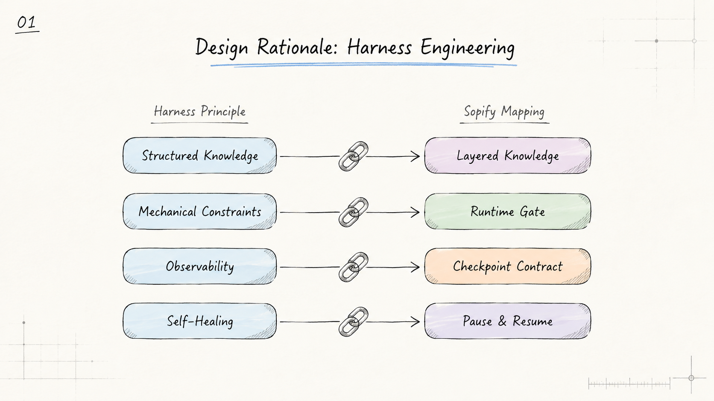
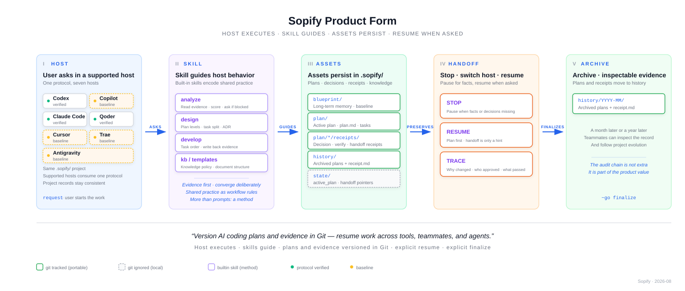
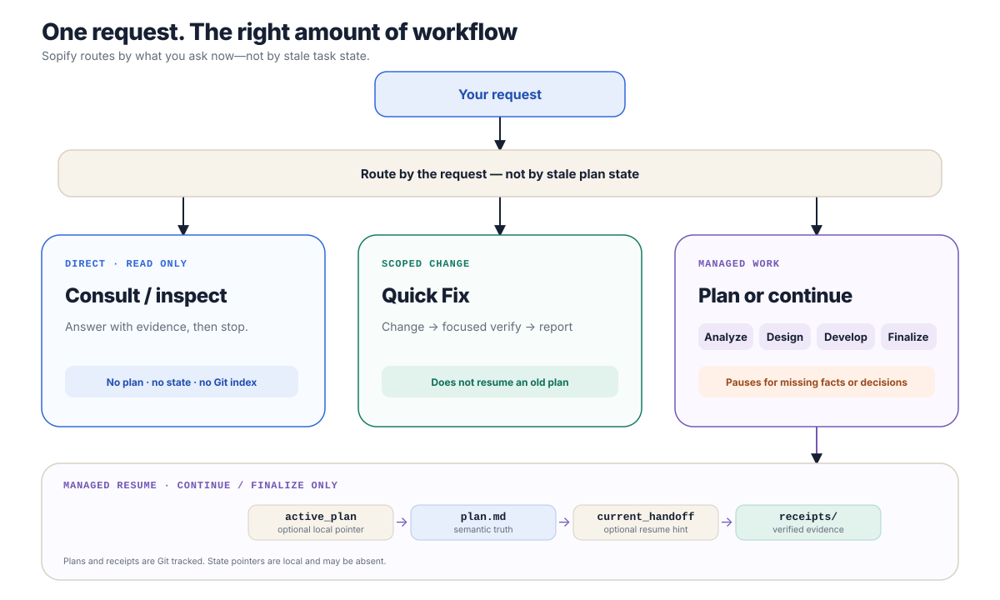
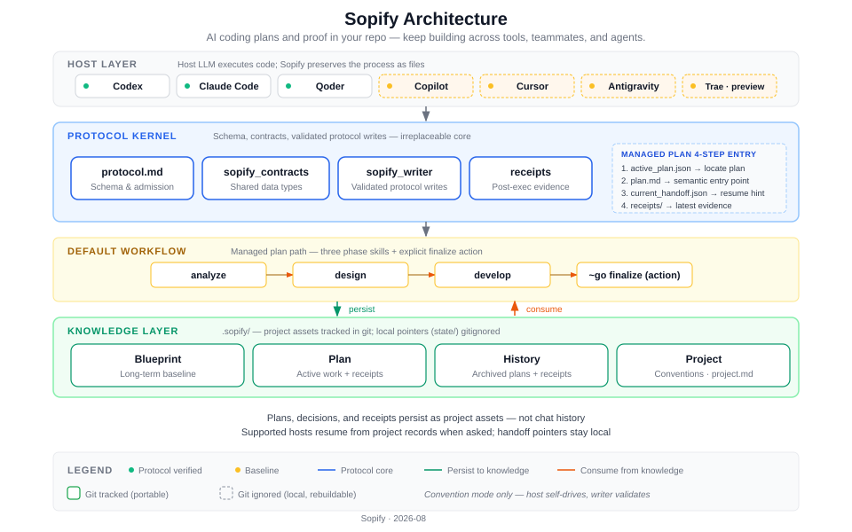
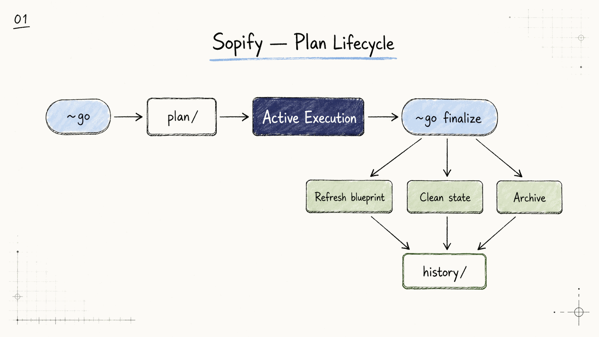

# How Sopify Works

## Design Rationale: Harness Engineering

Sopify borrows harness engineering ideas, but does not use them as the repository's homepage identity. This section explains design rationale, not product positioning.

> **Note:** The diagram below shows the original design inspiration. Some concepts (e.g. "runtime gate") have been retired in the current architecture — see [Core Value](#core-value-auditable-ai-development-assets) and [Protocol Entry](#protocol-entry-4-step-read-chain) for the current model.

<div align="center">

</div>

Official reference: [`Harness engineering: leveraging Codex in an agent-first world`](https://openai.com/index/harness-engineering/)

## Core Value: Auditable AI Development Assets

Sopify preserves the **process** of AI development — plans, decisions, handoffs, execution evidence, and archival records — as traceable assets. Cross-session and cross-host continuation is the natural result of these assets being portable and verifiable.

The AI coding host executes. Sopify ensures every decision leaves a trace that survives session boundaries, host switches, and team handoffs.

**Runtime retired; workflow retained.** The analyze → design → develop → finalize workflow is unchanged. What changed is that workflow rules now live in protocol files and host prompt assets, not in a runtime process.

### Product Form

<div align="center">

</div>

Sopify supplies shared workflow rules and preserves plans, decisions, and verification evidence as project files in `.sopify/`. Local resume pointers remain on the machine.

Sopify does three things:

- **Shared workflow protocol** — each adapter delivers the same protocol through the host surfaces it supports; entry mode and verification level remain explicit
- **Git-tracked project record** — plans, decisions, and verification evidence travel with the repository; local pointers do not
- **Explicit resume and closeout** — ask to continue or use `~go` before the host resumes; `~go finalize` archives the plan only after delivery evidence is ready

## Main Workflow

<div align="center">

</div>

Workflow notes:

- The host reads protocol entry instructions from its prompt asset (installed via `install.sh --target <host>`)
- Managed plan / continuation / finalize uses the [protocol entry below](#protocol-entry-4-step-read-chain).
- Consult and quick-fix requests do **not** auto-continue the active plan
- Stale or invalid state does not interrupt ordinary questions; it is handled only when the user enters a managed-plan action
- State writes go through `sopify_writer` (the only write path for protocol assets)

### Checkpoint Pause and Resume

The workflow includes two canonical checkpoint types:

- `answer_questions` — collects missing facts before a formal plan is materialized
- `confirm_decision` — resolves design branches before resuming execution

Both are expressed through `current_handoff.required_host_action`, not separate state files.

### Task Loop and Modes

- **Task loop**: Develop picks the next ready task from `tasks.md` (or `plan.md` for a light plan) by dependency and number, then runs implement → verify → review. A task is checked `[x]` only after verification and every review pass. After a first verification failure, it may retry once with the failure context; after a second failure, or without a retry, it records the root cause and then fixes and re-verifies, leaves the result unverified, marks the task blocked `[!]`, or sends the plan back for review. While a task is blocked, only tasks that do not depend on it continue.
- **Completion and archive**: Once tasks, verification and any required knowledge updates are done, the plan is marked `ready_to_archive` and stays in `plan/`. Only `~go finalize` moves it to `history/`.
- **Receipts**: An execution event in a managed plan writes `exec_NNN`; a verification or audit result adopted as formal evidence writes `verify_NNN`; archiving writes `final`. Planning without execution or verification events writes none, and plain questions and unmanaged small fixes stay outside the receipt flow.

| Dimension | Values | Notes |
|---|---|---|
| Request intent | question, small fix, new plan, continue, finalize | Decided by the host on every turn; questions and small fixes do not enter the plan workflow |
| `workflow.mode` | `adaptive` (default), `strict`, `minimal` | Optional: `strict` confirms after analysis and design; `minimal` skips planning but keeps authorization and protocol boundaries |
| Plan level | `light`, `standard`, `architecture` | Chosen by Design: `plan.md` only; plus `tasks.md`; plus `design.md` |
| Interaction | chat, non-interactive | A non-interactive session ends its turn when it asks a question; send the answer with the next request. The host's first automatic project setup needs an interactive session |

## Protocol Entry (4-Step Read Chain)

When the host detects `.sopify/` and the user request targets managed plan / continuation / finalize:

```
1. state/active_plan.json     → locate plan_id (if missing → consult / new-plan)
2. plan/<id>/plan.md          → semantic entry: goals + progress (truth source)
3. state/current_handoff.json → resume hint + whether waiting for user
4. plan/<id>/receipts/        → latest 1-3 receipts (what's been verified)
```

**Design principle**: read `plan.md` first for semantic truth, then `current_handoff` as a resume hint. The handoff is never a second truth source; `active_plan.json` stores only `plan_id`, while wave and task progress stay in plan files. A complete plan is identified by `plan_version`; standard tasks and architecture design both participate in that version. MCP may aggregate these facts, but it is not required for protocol entry.

**If state files are missing** (e.g. fresh clone on a new machine): `active_plan.json` and `current_handoff.json` are gitignored by design. The host browses `plan/` for candidates only when the user starts, continues, or finalizes managed work; an ordinary question never auto-resumes an old plan. Plans and receipts are always in git — only the "where am I right now" pointer is local.

### Optional Verifiers

Sopify does not run a verifier by default. For optional installation and component ownership, see [Getting Started](./getting-started.md). Installation proves placement and health; host discovery and audit behavior require separate evidence.

Independent audits do not need a plan binding. A formal plan-wide audit may live in `audits/plan/`, while focused audits may use `audits/<scope>/`; the host writes a receipt only when the user adopts the result as formal evidence. `audits/` is not part of the default 4-step read chain.

## Directory Structure and Layers

For the internal layering behind the product form:

<div align="center">

</div>

```text
.sopify/
├── blueprint/                   # L1 long-lived blueprint (git tracked)
│   ├── README.md
│   ├── background.md
│   ├── design.md
│   ├── tasks.md
│   └── protocol.md
├── plan/                        # L2 active plans (git tracked)
│   └── <plan_id>/
│       ├── plan.md              # sole semantic entry
│       ├── tasks.md             # optional (standard+)
│       ├── design.md            # optional (architecture level)
│       ├── audits/              # optional audit reports; not read by default
│       └── receipts/            # execution/verification evidence
├── history/                     # L3 archived plans (git tracked)
│   ├── index.md
│   └── YYYY-MM/
├── state/                       # protocol state (gitignored, 2 files only)
│   ├── active_plan.json         # current plan pointer
│   └── current_handoff.json     # resume hint + required_host_action
├── user/
│   ├── preferences.md
│   └── feedback.jsonl
├── sopify.json                  # workspace activation marker
└── project.md                   # project conventions
```

Layer notes:

- `blueprint/` stores durable knowledge, protocol spec, and stable contracts
- `plan/` stores active work packages with process audit assets (receipts)
- `history/` stores finalized plans with archival receipts
- `state/` is the minimal protocol state layer — only 2 files, always gitignored

## Host Support

See the current [host support and installation table](../README.md#supported-hosts); this page does not maintain another copy.

## Appendix: Plan Lifecycle

<div align="center">

</div>

This appendix is maintainer-oriented; most users only need the main workflow.
