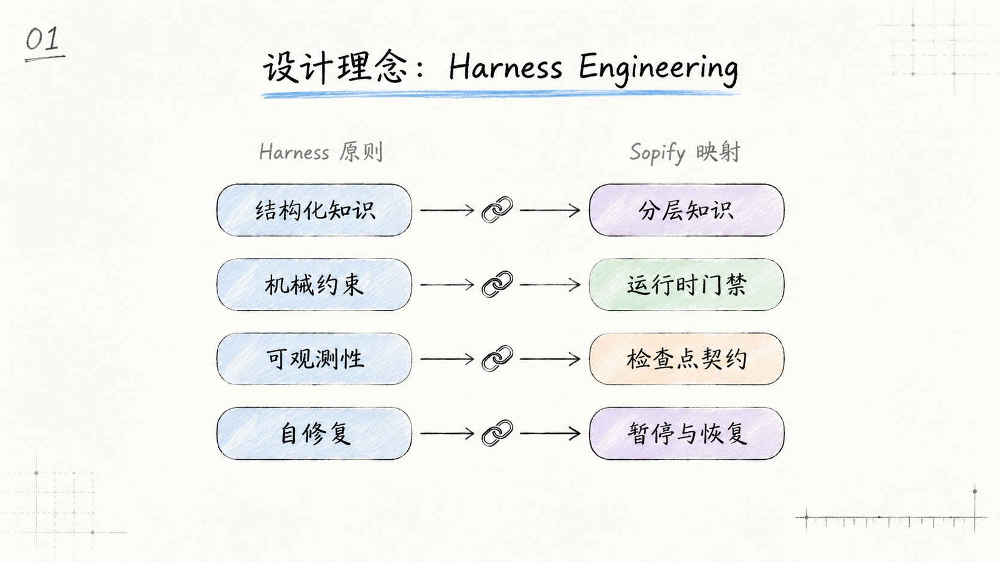
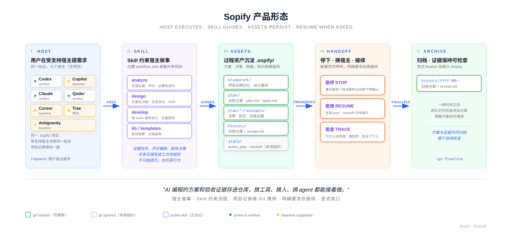
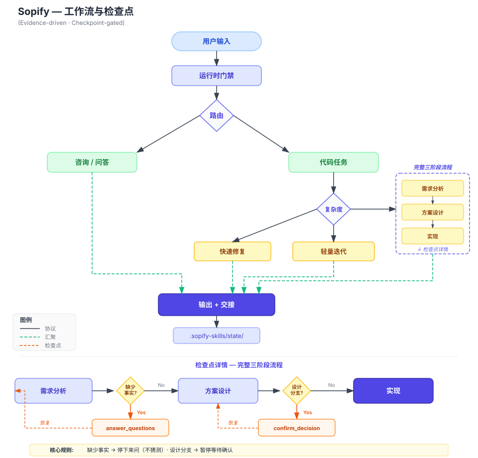
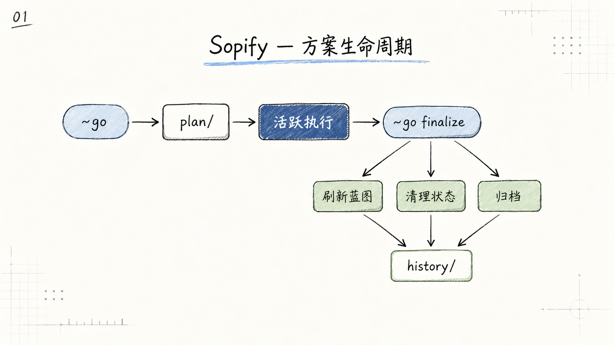

# Sopify 如何工作

## 设计来源：Harness Engineering

Sopify 借鉴 harness engineering 的设计思路，但不把它作为仓库首页定位。这里说明的是设计来源，不是产品口号。

> **说明**：下图展示的是原始设计灵感来源。部分概念（如"运行时门禁"）在当前架构中已退场——当前模型请见[核心价值](#核心价值ai-开发审计资产)和[协议入口](#协议入口4-步读链)章节。

<div align="center">

</div>

官方参考：[`Harness engineering: leveraging Codex in an agent-first world`](https://openai.com/index/harness-engineering/)

## 核心价值：AI 开发审计资产

Sopify 把 AI 开发过程中的**方案、决策、交接、执行/验证证据和归档记录**沉淀为可追溯资产。跨 session、跨宿主的接续是这些资产可携带、可验证后的自然结果。

AI 编程宿主负责执行。Sopify 确保每个决策都留下痕迹，且这些痕迹能跨越 session 边界、宿主切换和团队交接。

**Runtime 已退场；工作流保留。** analyze → design → develop → finalize 的默认工作流不变。变化的是：工作流规则现在活在协议文件和宿主 prompt 资产里，而不是 runtime 进程里。

### 产品形态

<div align="center">

</div>

Sopify 提供共享工作流规则，并把方案、决策和验证证据作为项目文件保存在 `.sopify/` 中；本地恢复指针只留在当前机器。

Sopify 主要做三件事：

- **共享工作流协议** — 各适配器通过宿主已支持的入口交付同一协议；入口形态与验证档位保持显式
- **项目记录随 Git 携带** — 方案、决策和验证证据跟着仓库走，本地指针不跟随
- **明确接续与收口** — 说“继续”或输入 `~go` 后，宿主才会恢复；交付证据就绪后，`~go finalize` 才归档方案

## 主工作流

<div align="center">

</div>

工作流要点：

- 宿主从已安装的 prompt 资产中读取协议入口指令（通过 `install.sh --target <host>` 安装）
- managed plan / continuation / finalize 按[下文协议入口](#协议入口4-步读链)恢复上下文
- consult 和 quick-fix 请求**不**自动接续 active plan
- 陈旧或无效状态不会打断普通问答；只有进入方案操作时才按用户意图处理
- 状态写入统一走 `sopify_writer`（协议资产的唯一写路径）

### Checkpoint 暂停与恢复

工作流包含两种 canonical checkpoint：

- `answer_questions` — 补事实，不提前物化正式 plan
- `confirm_decision` — 拍板分叉，确认后再恢复执行

两者都通过 `current_handoff.required_host_action` 表达，不再是独立 state 文件。

### 任务循环与模式

- **任务循环**：Develop 从 `tasks.md`（light 方案为 `plan.md`）里按依赖和编号选择可执行项，逐项「实现 → 验证 → 复审」，验证与各项复审均通过后才勾选 `[x]`。首次验证失败可带失败上下文自动重试一次；再次失败或放弃重试时记录根因，按原因修复后再验证、保留未验证状态、标为阻塞 `[!]` 或退回方案审查。有阻塞项时，只继续不依赖它的任务。
- **完成与归档**：任务、验证和所需的知识更新完成后，方案标为 `ready_to_archive` 并留在 `plan/`；只有 `~go finalize` 才归档到 `history/`。
- **回执**：受管方案实际发生执行事件时写 `exec_NNN`，验证或审计结果被采用为正式证据时写 `verify_NNN`，归档时写 `final`。只有规划而没有执行、验证事件时不写；普通问答和非受管小修不进入回执流程。

| 维度 | 取值 | 说明 |
|---|---|---|
| 请求意图 | 问答、小修、新方案、继续、收口 | 宿主每轮先判断；问答和小修不进入方案流程 |
| `workflow.mode` | `adaptive`（默认）、`strict`、`minimal` | 可选配置：`strict` 在分析和设计后逐阶段确认；`minimal` 省略规划，仍遵守授权和协议边界 |
| 方案级别 | `light`、`standard`、`architecture` | 由 Design 选择：只有 `plan.md`；加 `tasks.md`；再加 `design.md` |
| 交互方式 | 对话、非交互 | 非交互会话遇到提问会结束本轮，下一次请求需带上答案；宿主首次自动绑定项目时需要交互会话 |

## 协议入口（4 步读链）

当宿主检测到 `.sopify/` 且用户请求指向 managed plan / continuation / finalize 时：

```
1. state/active_plan.json     → 定位 plan_id（缺失则进入 consult / new-plan）
2. plan/<id>/plan.md          → 语义入口：目标 + 进度（真相源）
3. state/current_handoff.json → 恢复提示 + 是否等用户
4. plan/<id>/receipts/        → 最新 1-3 个 receipt（哪些已验证）
```

**设计原则**：先读 `plan.md` 建立语义真相，再读 `current_handoff` 作为恢复提示。handoff 永远不是第二真相源；`active_plan.json` 只保存 `plan_id`，Wave 和任务进度留在方案文件中。完整方案用 `plan_version` 识别，standard 的 tasks 和 architecture 的 design 都参与版本。MCP 可帮助读取这些事实，但不是协议入口的依赖。

**状态文件缺失时**（如新机器 fresh clone）：`active_plan.json` 和 `current_handoff.json` 按设计被 gitignore。只有用户要新建、继续或收口方案时，宿主才浏览 `plan/` 发现候选并按用户意图处理；普通问答不会因此自动恢复旧方案。方案和收据始终在 git 里——只有"我现在在哪"的指针是本地的。

### 可选验证器

Sopify 不默认执行验证器。可选安装与组件归属统一见 [Getting Started](./getting-started.md)。安装只证明放置和健康检查，宿主发现与审计行为仍需独立证据。

独立审计不必绑定方案。正式方案主审计可放在 `audits/plan/`，针对性审计可放在 `audits/<scope>/`；只有用户采用为正式证据时，宿主才通过 writer 写 receipt。`audits/` 不进入 4 步默认读取链。

## 目录结构与层级

产品形态背后的内部层次：

<div align="center">

</div>

```text
.sopify/
├── blueprint/                   # L1 长期蓝图（git tracked）
│   ├── README.md
│   ├── background.md
│   ├── design.md
│   ├── tasks.md
│   └── protocol.md
├── plan/                        # L2 活跃方案（git tracked）
│   └── <plan_id>/
│       ├── plan.md              # 唯一语义入口
│       ├── tasks.md             # 可选（standard+）
│       ├── design.md            # 可选（architecture 级）
│       ├── audits/              # 可选审计报告，不进入默认读取链
│       └── receipts/            # 执行/验证证据
├── history/                     # L3 已归档方案（git tracked）
│   ├── index.md
│   └── YYYY-MM/
├── state/                       # 协议状态（gitignored，仅 2 文件）
│   ├── active_plan.json         # 当前 plan 指针
│   └── current_handoff.json     # 恢复提示 + required_host_action
├── user/
│   ├── preferences.md
│   └── feedback.jsonl
├── sopify.json                  # workspace 激活标记
└── project.md                   # 项目技术约定
```

层级说明：

- `blueprint/` 承载长期知识、协议规范与稳定契约
- `plan/` 保存当前工作方案与过程审计资产（receipts）
- `history/` 保存已收口方案与归档收据
- `state/` 是最小协议状态层——仅 2 文件，始终 gitignored

## 宿主支持

当前支持范围与安装 target 见 [README 宿主表](../README.zh-CN.md#支持的宿主)，此处不再维护一份副本。

## 附录：Plan 生命周期

<div align="center">

</div>

附录只用于说明维护者视角的收口过程；普通用户理解主工作流即可。
